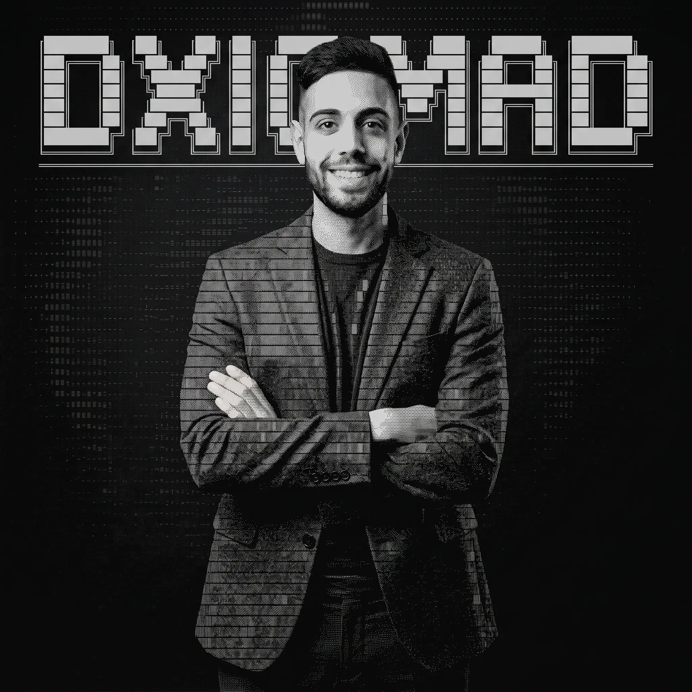

<div align="center">



### Ahmed Emad Nasr — Information Security Officer

[](https://ahmed-emad-nasr.github.io/)

[](https://ahmed-emad-nasr.github.io/)
[](https://ahmed-emad-nasr.github.io/blog)
[](https://ahmed-emad-nasr.github.io/teaching)
[](https://www.linkedin.com/in/ahmed-emad-nasr/)
<br/>
[](https://tryhackme.com/p/Ahmed.Emad.Nasr)
[](https://cyberdefenders.org/p/ahmed.em.nasr)
[](https://www.youtube.com/@AhmedEmad-0x3omda)
[](mailto:ahmed.em.nasr@gmail.com)

</div>

---

## `> whoami`

```yaml
name        : Ahmed Emad Nasr
alias       : 0x3omda
role        : Information Security Officer — GRC · SOC · IR/DFIR · Malware Analysis · IAM
teaching    : Cybersecurity Instructor @ AMIT Learning & NTI (160-hour SOC diploma)
education   : B.Sc. CS — InfoSec & Digital Forensics, Benha University (GPA 3.78/4.0)
              Ranked 8th / 900 students
certs       : eJPT v2 (90%) · CCNA 200-301 · RH124 · CCEP · SOC L1+L2 (THM)
location    : Cairo, Egypt
open_to     : Information Security roles — SOC (T1/T2) · Incident Response · Detection Engineering · GRC
```

I build detection labs, break them on purpose, then tune the rules until the noise
goes away. Every case is written up on [**my blog**](https://ahmed-emad-nasr.github.io/blog) —
logs, rules, IOCs and the full report, not just screenshots.

---

## `> tail -n 5 /blog/feed.xml`

<!-- The list between the two markers is refreshed every day by
     .github/workflows/blog-posts.yml from the blog's RSS feed. -->
<!-- BLOG-POST-LIST:START -->
- [SOC L1 Alert Triage Walkthrough (SIEM Prioritization, VirusTotal OSINT & LummaStealer Detection)](https://ahmed-emad-nasr.github.io/blog/soc-l1-alert-triage) <sub>Nov 2026</sub>
- [IR Timeline Analysis Walkthrough (Plaso, Log2Timeline, Pinfo, Psort & Timesketch)](https://ahmed-emad-nasr.github.io/blog/ir-timeline-analysis) <sub>Nov 2026</sub>
- [Threat Intelligence for SOC Walkthrough (Kibana, Uncoder.io, Sigma & ElastAlert)](https://ahmed-emad-nasr.github.io/blog/threat-intelligence-for-soc) <sub>Nov 2026</sub>
- [Vulnerability Scanning Tools Walkthrough (Nmap, Nikto & OpenVAS)](https://ahmed-emad-nasr.github.io/blog/vulnerability-scanning-tools) <sub>Oct 2026</sub>
- [2FA Simple Bypass](https://ahmed-emad-nasr.github.io/blog/2fa-simple-bypass) <sub>Oct 2026</sub>
<!-- BLOG-POST-LIST:END -->

➜ **[All 82 cases](https://ahmed-emad-nasr.github.io/blog)** · searchable by tool, tactic and platform, mapped to MITRE ATT&CK.

---

## `> git log --author=0x3omda --oss`

> **Merged a custom Wazuh detection rule into [SOC Fortress](https://github.com/socfortress) — an open-source SOC project with 1.5k+ stars.**
> Rule contributed via PR, reviewed and merged upstream. → [View the ruleset](https://github.com/socfortress/Wazuh-Rules)

---

## `> ls -la /ops/projects/`

### 🛡️ Enterprise SOC Lab & Insider Threat Deception
`Wazuh` `Suricata` `Zeek` `Sysmon` `auditd` `YARA` `pfSense` `Python`

Full detection stack across 5+ endpoints, with a honeytoken-based insider threat layer on top.

- Simulated **50+ attacks** to validate rules → **95%+ true positive rate**
- Expanded detection coverage by **12%**; alerts surfaced in **under 60s**
- **100% detection rate** across 3 insider threat scenarios; cut false positives by **12 alerts/week**
- Python agent: hashes files → queries VirusTotal → auto-quarantines flagged samples

**[→ SOC lab repo](https://github.com/Ahmed-Emad-Nasr/SOC-Environment)** · **[→ Insider threat repo](https://github.com/Ahmed-Emad-Nasr/insider-threat-detection-deception)** · **[→ Case study](https://ahmed-emad-nasr.github.io/blog/soc-env-depi-r3-project)**

---

### 🦠 Malware Analysis & Prevention Strategy
`YARA` `PEStudio` `CFF Explorer` `FakeNet-NG` `Process Hacker` `Isolated Sandbox`

- Analyzed **20+ samples** (5+ ransomware families) in an isolated lab; extracted actionable IOCs
- Dynamic analysis with FakeNet-NG + Process Hacker to map **C2 traffic behavior**
- Built a **PDF parser** that detects and extracts embedded JavaScript payloads — *18+ downloads*
- Fed IOCs back into Wazuh rules → **MTTD reduced by 25%**

**[→ Repo](https://github.com/Ahmed-Emad-Nasr/Malware-Analysis-and-Prevention-Strategy)** · **[→ PDF parser](https://github.com/Ahmed-Emad-Nasr/3omda-PDFparser-tool)** · **[→ Case study](https://ahmed-emad-nasr.github.io/blog/depi-r4-project)**

---

### ⚖️ VerifAI 360 — AI-Driven GRC Platform
`Python` `Streamlit` `ISO 27001` `NIST CSF` `PCI DSS` `GDPR`

- Dynamic risk scoring, automated gap detection and tailored remediation recommendations
- Automated control mapping across **150+ frameworks** → assessments **15% faster**

**[→ Repo](https://github.com/Ahmed-Emad-Nasr/VerifAI360-Compliance-Framwork)** · **[→ Demo video](https://youtu.be/G-Ys6VuV91g)**

---

### 🔎 Threat Intelligence Platform
`Python` `VirusTotal API` `Exploit-DB` `CLI`

- Python CLI aggregating IOCs and CVEs from multiple feeds into one lookup
- **10 stars on GitHub** — cuts manual enrichment time per investigation

**[→ Repo](https://github.com/Ahmed-Emad-Nasr/Threat-Intelligence-Tool)** · **[→ Demo video](https://youtu.be/u_hezaAwnmM)**

➜ **[Every project](https://ahmed-emad-nasr.github.io/#projects)** on the portfolio, with screenshots and results.

---

## `> cat /ops/defense_map.txt`

```
               ┌──────────────────────┐
               │   INCIDENT RESPONSE  │
               │      NIST 800-61     │
               └───────────┬──────────┘
                           │
   ┌────────────┐   ┌──────▼─────┐   ┌────────────────┐
   │    DFIR    │◄──┤  0x3OMDA   ├──►│MALWARE ANALYSIS│
   │ Volatility │   │ SOC / BLUE │   │ YARA·PEStudio  │
   │  Autopsy   │   │    TEAM    │   │     Sandbox    │
   └────────────┘   └──────┬─────┘   └────────────────┘
                           │
   ┌────────────┐   ┌──────▼─────┐   ┌────────────────┐
   │THREAT HUNT │◄──┤PURPLE TEAM ├──►│      GRC       │
   │SIEM·ATT&CK │   │ ART·ATT&CK │   │ ISO27001·NIST  │
   └────────────┘   └────────────┘   └────────────────┘
```

---

## `> cat /teaching/now.txt`

```
AMIT Learning        Cybersecurity Instructor     160-hour track: CCNA → Linux → Security+ → SANS → SIEM
NTI                  Cybersecurity Instructor     42+ students · 85%+ pass rate · 120+ lab hours
GDG                  Best Technical Instructor    1st of 250 instructors · 35+ sessions · 10+ CTF challenges
YouTube              @AhmedEmad-0x3omda           500+ subscribers · 60,000+ views
```

➜ **[The full diploma, module by module, and what my students wrote](https://ahmed-emad-nasr.github.io/teaching)** · [بالعربي](https://ahmed-emad-nasr.github.io/ar/teaching)

---

## `> cat /skills/arsenal.conf`

**SIEM & Monitoring**


**DFIR & Malware Analysis**


**Purple Team & Offensive**


**Automation & Infrastructure**


**GRC & Frameworks**


---

## `> cat /certs/achievements.log`

| Year | Certification | Issuer | Result |
|:----:|:--------------|:-------|:-------|
| 2026 | eJPT v2 | INE | **90%** |
| 2026 | Certified Cybersecurity Educator Professional (CCEP) | Red Team Leaders | Active |
| 2026 | Red Hat System Administration I (RH124) | Red Hat | Active |
| 2025 | Information Security Analyst | DEPI | Active |
| 2025 | SOC Level 1 & SOC Level 2 Paths | TryHackMe | Active |
| 2025 | Malware Analysis Fundamentals | ITI Mahara-Tech | Active |
| 2025 | Cyber Threat Intelligence 101 | arcX | Active |
| 2025 | HCCDA-Tech Essentials | Huawei | Active |
| 2024 | CCNA 200-301 | Cisco | Active |

➜ **[The original certificates](https://ahmed-emad-nasr.github.io/gallery)**

---

## `> cat /awards/trophies.txt`

```
🏆  Best Technical Instructor  — GDG, ranked 1st out of 250 instructors
🎓  Academic Excellence        — 8th / 900 in InfoSec & Digital Forensics
🔴  TryHackMe                  — Top 1% globally
🏅  ITI & CyberTalents CTF     — 44th / 450
🌍  HackTheBox University CTF  — 199th / 1,128 (Binary Badlands 2024)
💻  ECPC                       — Top 250 / 1,500 teams
🎥  YouTube channel            — 500+ subscribers · 60,000+ views
📝  Portfolio & blog           — 1,200+ organic visitors · 82 case studies
⭐  DEPI Round 4               — Officially recognized Top Achiever
```

---

## `> htop --user=0x3omda`

<div align="center">
  
  
</div>

---

## `> uptime`

```
Currently   : Detection engineering · DFIR case studies · GRC automation · teaching at AMIT & NTI
Next targets: BTL1 · SC-200 · CHFI · CEH
Active since: 2022
Status      : Learning every single day ↑
```

---

<div align="center">

**Hiring for information security?** I'm open to SOC, incident response, detection engineering and GRC roles.
**Need training for your team?** The diploma, or any module of it — [request a training](mailto:ahmed.em.nasr@gmail.com?subject=Cybersecurity%20training%20request).

📫 [ahmed.em.nasr@gmail.com](mailto:ahmed.em.nasr@gmail.com) · [LinkedIn](https://www.linkedin.com/in/ahmed-emad-nasr/) · [Portfolio](https://ahmed-emad-nasr.github.io/) · [Blog](https://ahmed-emad-nasr.github.io/blog)


</div>
